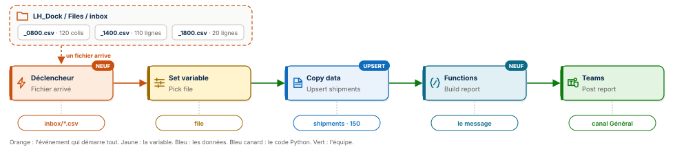

# 📦 Fabric Pipeline Express 7 : déclencher, fusionner, calculer, prévenir


Un pipeline Microsoft Fabric Data Factory que personne ne lance. Un fichier de suivi de colis arrive dans le lakehouse, et le pipeline démarre seul. Il fusionne les colis dans une table Delta par Upsert, sans jamais doubler une ligne, fait rédiger le compte rendu de la vague par une fonction Python hébergée dans Fabric, et le publie dans Microsoft Teams.

**Guide PDF de 7 pages inclus** : [`Pipeline_Fabric_Guide_7_public.pdf`](Pipeline_Fabric_Guide_7_public.pdf). Chaque activité, chaque champ, chaque expression expliquée, et les chiffres à retrouver à l'unité près. Le code Python et toutes les expressions sont aussi dans [`data/expressions.txt`](data/expressions.txt), prêts à copier.



## 📸 Aperçu

Le pipeline `PL_Dock_Express` après son exécution par le déclencheur : quatre activités vertes, de la variable au message Teams.


Le compte rendu publié dans le canal Général à 02:16. Personne n'a cliqué sur Exécuter : le dépôt du fichier de 18 h a suffi, et la fonction Python a écrit la phrase.


La table `shipments` interrogée dans le point de terminaison SQL du lakehouse, après les trois vagues : 150 colis, 150 identifiants distincts, et la répartition par statut.


## 🎯 Résultats clés

| Indicateur | Valeur |
|---|---|
| Activités | 4 (Set variable, Copy data, Functions, Microsoft Teams) et un déclencheur |
| Nouveautés | 3 : déclencheur sur événement OneLake, copie en Upsert, activité Functions |
| Vagues de colis | 3 : 8 h, 14 h, 18 h |
| Lignes reçues | 260 (120 + 110 + 20) |
| Colis en table | 150, chacun une seule fois |
| Colis livrés après la vague de 18 h | 35 |
| Du dépôt du fichier au message Teams | environ deux minutes |
| Clics pour lancer la dernière vague | 0 |

## 💼 Impact métier

Le quai de Metz reçoit trois fois par jour un fichier de suivi : les colis préparés le matin, les départs et les nouveaux colis à midi, les livraisons le soir. Chaque fichier mélange des colis inconnus et des colis déjà suivis dont le statut a changé. Avec un pipeline planifié, on choisit entre tourner pour rien et rater un fichier arrivé juste après l'horaire. Ici, l'arrivée du fichier est l'horaire. La table reste exacte, un colis par ligne, et l'équipe lit le bilan de chaque vague dans Teams, là où elle travaille déjà.

## 📝 Résumé

Le déclencheur `TR_Dock_Inbox` écoute le dossier `Files/inbox` du lakehouse `LH_Dock`. À chaque fichier `.csv` créé, il lance `PL_Dock_Express` et lui transmet l'événement. L'activité `Pick file` lit le nom du fichier dans cet événement, ou dans un paramètre quand on lance à la main. `Upsert shipments` copie le fichier dans la table Delta `shipments` en Upsert sur la clé `shipment_id` : les nouveaux colis sont insérés, les colis connus sont mis à jour. `Build report` appelle la fonction Python `build_report` de `FN_Dock`, qui lit l'heure de la vague dans le nom du fichier et rédige le compte rendu. `Post report` le publie dans Teams.

## 🔁 Pipeline

| Élément | Type | Rôle |
|---|---|---|
| `TR_Dock_Inbox` | Déclencheur, événements OneLake | `Microsoft.Fabric.OneLake.FileCreated` sur `Files/inbox`, filtre `subject` se termine par `.csv` |
| `Pick file` | Set variable | `@coalesce(pipeline()?.TriggerEvent?.FileName, pipeline().parameters.file_name)` |
| `Upsert shipments` | Copy data | `LH_Dock/Files/inbox/@{variables('file')}` vers la table `shipments`, action Upsert, clé `shipment_id` |
| `Build report` | Functions | `FN_Dock.build_report(fileName, rowsRead)` |
| `Post report` | Microsoft Teams | `@{activity('Build report').output.output}` dans le canal Général |

## 🧠 Les trois idées du projet

**L'événement remplace l'horaire.** OneLake publie un événement à chaque fichier créé. Activator le reçoit, applique le filtre et lance le pipeline en lui transmettant l'événement. Le nom du fichier n'est tapé nulle part : il voyage avec l'événement.

**Fusionner, pas empiler.** Upsert compare chaque ligne reçue à la table par sa clé. Absente, la ligne est insérée ; présente, elle remplace l'ancienne version. C'est un `MERGE`, sans une ligne de SQL. Rejouer un fichier ne double jamais rien.

**Du Python au cœur du pipeline.** La règle de rédaction vit dans une fonction de données utilisateur, publiée une fois dans Fabric, testable seule, et appelable par n'importe quel pipeline de l'espace de travail.

## 🚚 Le pipeline en une image

| Étape | Sur un quai de messagerie | Dans Fabric |
|---|---|---|
| 1 | La sonnette retentit : un bordereau est arrivé | Le déclencheur reçoit l'événement OneLake |
| 2 | Le chef de quai prend ce bordereau | `Pick file` lit le nom du fichier |
| 3 | Le registre met à jour chaque fiche de colis | `Upsert shipments` fusionne par `shipment_id` |
| 4 | Le secrétaire rédige le compte rendu | La fonction Python `build_report` |
| 5 | Le haut-parleur annonce la vague | Microsoft Teams |

## 🧬 Traçabilité

```
LH_Dock / Files / inbox / shipments_2026-10-14_1800.csv     fichier créé
   │  Événement OneLake  Microsoft.Fabric.OneLake.FileCreated
   │  Activator, règle TR_Dock_Inbox   filtre : dossier inbox, subject se termine par .csv
   ▼
PL_Dock_Express
   │  Set variable  Pick file          file = shipments_2026-10-14_1800.csv
   │  Copy data     Upsert shipments   20 lignes lues, clé shipment_id
   ▼
LH_Dock / Tables / shipments                                150 colis, 35 livrés
   │  Functions     Build report       build_report(fileName, rowsRead = 20)
   ▼
Microsoft Teams  Post report
   « Quai de Metz, vague de 18 h 00 : 20 colis fusionnés dans shipments (vague normale). »
```

## 🏗️ Architecture

| Objet Fabric | Type | Rôle |
|---|---|---|
| `LH_Dock` | Lakehouse | Reçoit les fichiers dans `Files/inbox`, porte la table Delta `shipments` |
| `FN_Dock` | Fonctions de données utilisateur | Héberge la fonction Python `build_report` |
| `PL_Dock_Express` | Pipeline | Enchaîne les quatre activités, paramètre `file_name`, variable `file` |
| `TR_Dock_Inbox` | Règle Activator | Écoute OneLake et lance le pipeline |

La fonction qui rédige le compte rendu, dans [`fonction/build_report.py`](fonction/build_report.py) :

```python
import fabric.functions as fn

udf = fn.UserDataFunctions()

@udf.function()
def build_report(fileName: str, rowsRead: int) -> str:
    stamp = fileName.split("_")[-1].replace(".csv", "")
    if len(stamp) == 4 and stamp.isdigit():
        wave = stamp[0:2] + " h " + stamp[2:4]
    else:
        wave = stamp
    if rowsRead >= 115:
        load = "vague lourde"
    else:
        load = "vague normale"
    return "Quai de Metz, vague de " + wave + " : " + str(rowsRead) + " colis fusionnés dans shipments (" + load + ")."
```

Elle prend le nom du fichier et le nombre de lignes lues par la copie. Elle extrait l'heure de la vague (`1800` devient `18 h 00`), qualifie la charge (lourde dès 115 lignes) et rend une phrase prête à publier. Les noms de paramètres sont en camelCase, comme l'attendent les fonctions de données utilisateur Fabric.

## ▶️ Les quatre exécutions

| # | Lancement | Fichier | Lignes lues | Colis en table | Message reçu dans Teams |
|---|---|---|---|---|---|
| 1 | À la main | `shipments_2026-10-14_0800.csv` | 120 | 120 | Quai de Metz, vague de 08 h 00 : 120 colis fusionnés dans shipments (vague lourde). |
| 2 | À la main | `shipments_2026-10-14_1400.csv` | 110 | 150 | Quai de Metz, vague de 14 h 00 : 110 colis fusionnés dans shipments (vague normale). |
| 3 | À la main, même fichier | `shipments_2026-10-14_1400.csv` | 110 | 150 | Le même message : rejouer ne double rien |
| 4 | **Par le déclencheur** | `shipments_2026-10-14_1800.csv` | 20 | 150 | Quai de Metz, vague de 18 h 00 : 20 colis fusionnés dans shipments (vague normale). |

À la vague de 14 h, 110 lignes arrivent mais la table passe de 120 à 150 colis seulement : 80 colis connus changent de statut, 30 nouveaux s'ajoutent. À la vague de 18 h, 20 colis expédiés passent à livré et le total ne bouge pas.

## 📊 Résultat final

```sql
SELECT status, COUNT(*) AS colis FROM shipments GROUP BY status ORDER BY status;
```

| status | colis |
|---|---|
| EXPEDIE | 40 |
| **LIVRE** | **35** |
| PREPARE | 70 |
| RETARD | 5 |
| **Total** | **150** |

```sql
SELECT COUNT(*) AS colis, COUNT(DISTINCT shipment_id) AS ids FROM shipments;
```

| colis | ids |
|---|---|
| 150 | 150 |

## 📦 Jeu de données

```
data/
├── shipments_2026-10-14_0800.csv   120 colis préparés
├── shipments_2026-10-14_1400.csv   80 colis qui changent de statut, 30 nouveaux
├── shipments_2026-10-14_1800.csv   20 colis expédiés qui passent à livré
└── expressions.txt                 le code Python et toutes les expressions du guide
```

Six colonnes : `shipment_id`, `client`, `destination`, `weight_kg`, `status`, `updated_at`. Quatre statuts : `PREPARE`, `EXPEDIE`, `LIVRE`, `RETARD`. Six clients de Metz (Librairie Hisler, Boulangerie Saint-Louis, Fromagerie Taburet, Cycles Mazelle, Pharmacie Serpenoise, Epicerie Pontiffroy) et six destinations du Grand Est et du Luxembourg. Données fictives, conçues pour l'exercice.

## 🚀 Reproduire l'exercice

1. Créer un lakehouse `LH_Dock`, un dossier `Files/inbox`, et y déposer les fichiers de 8 h et de 14 h. Garder celui de 18 h pour la fin.
2. Créer les fonctions de données utilisateur `FN_Dock`, coller le code de `fonction/build_report.py`, publier, tester.
3. Créer le pipeline `PL_Dock_Express` avec le paramètre `file_name` et la variable `file`, puis les quatre activités en copiant les expressions depuis `data/expressions.txt`.
4. Exécuter à la main avec le fichier de 8 h, puis celui de 14 h, deux fois.
5. Ajouter le déclencheur sur les événements OneLake du dossier `inbox`, puis déposer le fichier de 18 h et regarder le pipeline démarrer seul.

## 📂 Structure du dépôt

```
fabric-pipeline-express-7/
├── README.md
├── Pipeline_Fabric_Guide_7_public.pdf   le guide de 7 pages
├── data/                                les trois vagues de colis et les expressions
├── fonction/
│   └── build_report.py                  la fonction de données utilisateur
└── images/
    ├── pipeline_diagram.svg             le schéma du pipeline
    ├── pipeline_run.png                 PL_Dock_Express après l'exécution par le déclencheur
    ├── teams_message.png                le compte rendu de la vague de 18 h
    ├── sql_ids.png                      150 colis, 150 identifiants distincts
    └── sql_status.png                   la répartition par statut
```

## 🧰 Stack technique

Microsoft Fabric Data Factory · Événements OneLake · Activator · Lakehouse et Delta · Copy data en Upsert · Fonctions de données utilisateur (Python) · Point de terminaison SQL · Microsoft Teams

## ✅ Conclusion

Un pipeline n'a pas besoin d'horloge quand les données savent s'annoncer. Ici, le fichier qui arrive lance le traitement, l'Upsert garde la table exacte quelle que soit la vague, et une fonction Python transforme un nombre de lignes en une phrase que l'équipe comprend. Quatre activités, un déclencheur, et zéro clic.

## 💭 Dernier mot

Le meilleur moment pour traiter une donnée, c'est l'instant où elle arrive.

---

Abdoul Hamid Diallo · Microsoft Data & AI Engineer · Microsoft Certified DP-600, DP-700, PL-300, AI-102, DP-100, AI-900, DP-900 · [LinkedIn](https://www.linkedin.com/in/abdoul-hamid-diallo-fabric-data-engineer/)
